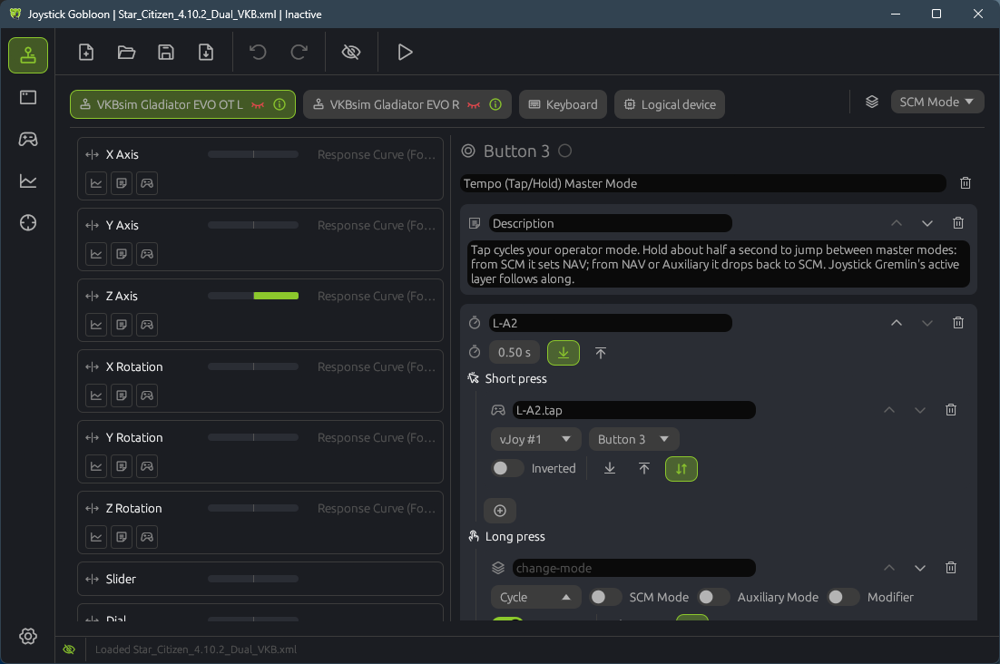
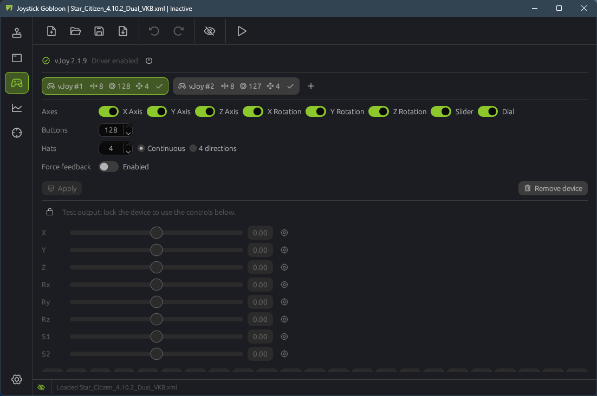
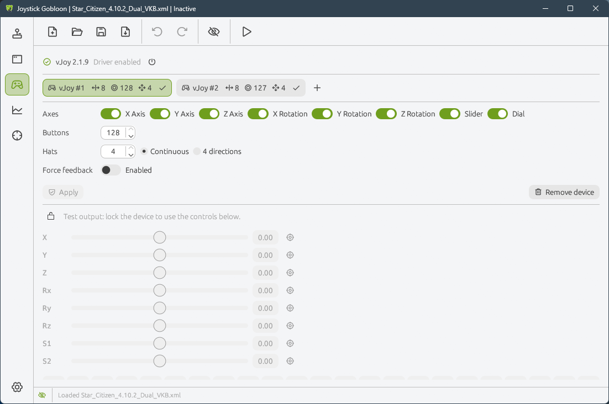
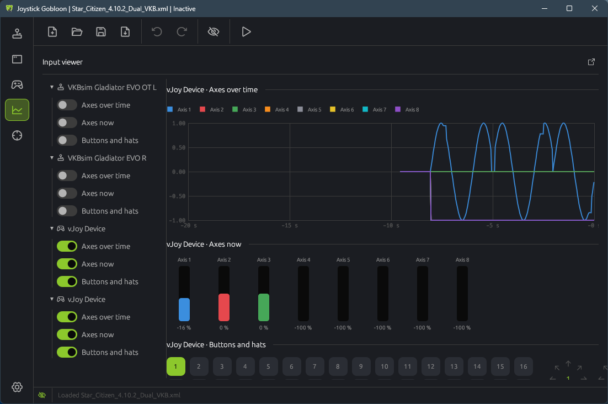
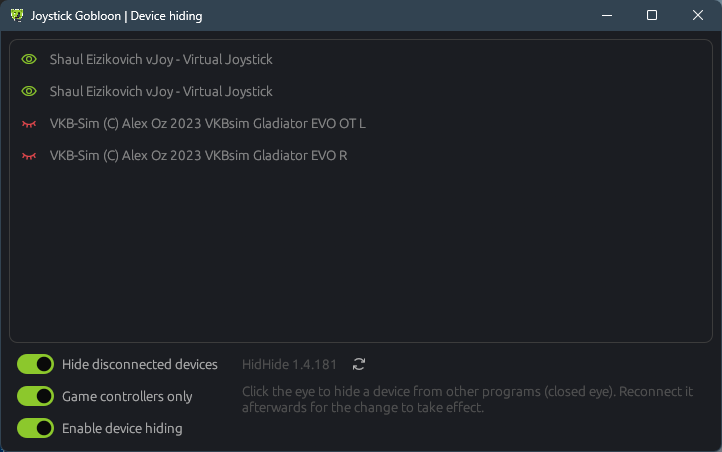

<p align="center">
  
</p>

<h1 align="center">Joystick Gobloon</h1>

<p align="center">
  <b>Device hiding, virtual joysticks and input mapping for Windows — in one app.</b>
</p>

<p align="center">
  <a href="https://github.com/h0useRus/JoystickGobloon/releases/latest"></a>
  <a href="https://github.com/h0useRus/JoystickGobloon/actions/workflows/ci.yml"></a>
  
  <a href="LICENSE"></a>
</p>

<p align="center">
  
</p>

---

Flight-sim and space-sim players with HOTAS setups usually run three tools side by side:
[HidHide](https://github.com/nefarius/HidHide) to hide the physical sticks from games,
[vJoy](https://github.com/jshafer817/vJoy) for virtual joysticks, and
[Joystick Gremlin](https://github.com/WhiteMagic/JoystickGremlin) to map one to the other.

**Joystick Gobloon** replaces the user interfaces of all three with a single fast, native app written in Rust.
It talks to the HidHide and vJoy drivers directly, opens your Joystick Gremlin profiles as they are, and keeps the
Gremlin workflow you already know.

## Features

### Profiles and bindings

- **Joystick Gremlin compatible** — opens Gremlin R14 profiles and saves them back in Gremlin's format without losing
  anything; actions Joystick Gobloon does not run yet are kept untouched.
- **All Gremlin R14 actions**: map to vJoy, response curves (piecewise linear, cubic spline, Bézier), modes,
  tempo (short / long press), double tap, chain, smart toggle, macros, keyboard and mouse output, split / merge axis,
  axis delta, dual-axis deadzone, hat as buttons, conditions, sounds, text to speech, run command, load profile and more
  ([full list](docs/GREMLIN_ACTIONS.md)).
- **Modes** with inheritance, per-mode overrides, **undo / redo**.
- **Keyboard keys and a logical device** as inputs, bound exactly like joystick buttons and axes.
- **Map controls** — a profile made on another PC is matched to your devices in one click.

### Virtual joysticks (vJoy)

- Create, change and remove vJoy devices right in the app — no *Configure vJoy*, one UAC prompt per change.
- Each device shows its axes, buttons and hats at a glance; a new device starts as a copy of the first one.
- A built-in **output tester**: lock a device and move its axes, buttons and hats by hand.

<p align="center">
  
  
</p>

### Device hiding (HidHide)

- Hide a physical stick from every game with one click on its eye; Joystick Gobloon itself still sees it.
- Manage which programs may see hidden devices, including HidHide's inverse mode.
- Toggle hiding for the whole system from the toolbar or the tray icon.

### Input viewer and calibration

- Live graphs of every axis, button and hat — physical sticks and vJoy devices alike, in the main window or its own.
- Axis calibration with center and end points.

<p align="center">
  
  
</p>

### Everyday comfort

- Tray icon, start with Windows, activate the profile on start.
- Light, dark or system theme.
- English, Русский, Deutsch, Español, Français, 简体中文 and 한국어 — more languages are a text file away.

## Getting started

1. Download the installer from the [latest release](https://github.com/h0useRus/JoystickGobloon/releases/latest)
   (or the portable zip). The installer also installs the signed **HidHide** and **vJoy 2.1.9.1** drivers when they
   are missing; Windows may ask for a restart afterwards.
2. Start Joystick Gobloon and import your Joystick Gremlin profile (toolbar → *Import*).
3. If the profile was made on another PC, use **Map controls** on the Devices page.
4. Hide your physical sticks (eye button in the toolbar) and press **Activate** (▶).

Requirements: Windows 10 or 11 (x64).

Code signing of releases through SignPath is being set up (see the [code signing policy](docs/CODE_SIGNING.md)).
Until then — and for a while after, until a new release has been downloaded often enough — Windows SmartScreen may
warn on the first start: choose *More info → Run anyway*.

> **Status:** alpha. Daily-driver features are in place and used with a Star Citizen dual-VKB profile; expect rough
> edges. See the [roadmap](docs/ROADMAP.md) and [releases](https://github.com/h0useRus/JoystickGobloon/releases).

## Building from source

Rust is pinned in [`rust-toolchain.toml`](rust-toolchain.toml).

```sh
cargo run -p joystick-gobloon                 # debug build
cargo build -p joystick-gobloon --release     # target/release/JoystickGobloon.exe
cargo test --workspace
```

| Crate | Purpose |
| --- | --- |
| `joystick-gobloon` | The eframe / egui application |
| `gob-core` | Profile model mirroring Joystick Gremlin R14 |
| `gob-gremlin` | Gremlin XML import / export, lossless round trip |
| `gob-engine` | Runs a profile: input → actions → vJoy, keyboard, mouse |
| `gob-input` | DirectInput polling and the keyboard hook |
| `gob-vjoy` | vJoy driver: output and device configuration |
| `gob-hidhide` | HidHide driver: hiding, application list |
| `gob-plugin` | Plugin API (early) |
| `gob-i18n` | Fluent translations |

## Translations

All texts live in [`lang/*.ftl`](lang) ([Fluent](https://projectfluent.org/) format). To add a language, copy
[`lang/en.ftl`](lang/en.ftl) to `lang/<code>.ftl`, translate the values and put the `lang` folder next to the
executable — or open a pull request to ship it with the app.

## Credits

Joystick Gobloon stands on the shoulders of
[HidHide](https://github.com/nefarius/HidHide) by Benjamin Höglinger-Stelzer (Nefarius),
[vJoy](https://github.com/shauleiz/vJoy) by Shaul Eizikovich (signed 2.1.9.1 build by
[Justin Shafer](https://github.com/jshafer817/vJoy)) and
[Joystick Gremlin](https://github.com/WhiteMagic/JoystickGremlin) by Lionel Ott.

Free code signing provided by [SignPath.io](https://about.signpath.io/), certificate by
[SignPath Foundation](https://signpath.org/).

## License

[MIT](LICENSE)
