# Actions

What an input does is a list of **actions**. Select an input on the Devices page, and its actions are on the
right: they run from top to bottom every time the input changes, and each one can pass a changed value on to the
next one (a response curve before *Map to vJoy*, for example). The ⊕ button adds an action. It can also link an
existing action, so several inputs share it, or copy one.

- **When it runs.** Button actions have three switches: on press, on release, or both. *Both* follows the button,
  so a vJoy button is held exactly as long as yours.
- **Containers.** Some actions hold other actions: tempo, double tap, condition, split axis and others. Their
  children are edited inside them.
- **Description.** The field above the list names the input; the name also shows on the input's card.
- **Modes and modifiers.** A mode can give an input different actions, and a held modifier can switch to another
  layer of actions. Both are described in the [README](../README.md#modifiers).

**Output:** [Map to vJoy](#map-to-vjoy) · [Map to gamepad](#map-to-gamepad) · [Map to keyboard](#map-to-keyboard) ·
[Map to mouse](#map-to-mouse) · [Map to logical device](#map-to-logical-device)
**Axes:** [Response curve](#response-curve) · [Split axis](#split-axis) · [Merge axis](#merge-axis) ·
[Dual axis deadzone](#dual-axis-deadzone) · [Axis delta](#axis-delta)
**Buttons and hats:** [Tempo](#tempo) · [Double tap](#double-tap) · [Smart toggle](#smart-toggle) · [Chain](#chain) ·
[Macro](#macro) · [Hat buttons](#hat-buttons) · [Condition](#condition)
**Profile:** [Change mode](#change-mode) · [Pause and resume](#pause-and-resume) · [Load profile](#load-profile)
**Other:** [Play sound](#play-sound) · [Text to speech](#text-to-speech) · [Run command](#run-command) ·
[Description](#description)

---

## Output

### Map to vJoy

Sends the value to a virtual joystick: an axis to an axis, a button to a button, a hat to a hat. Pick the vJoy
device and its input; a button can be inverted. An axis can also be **relative**: then the input sets the speed
at which the vJoy axis moves, and the axis stays where it is when you let go.

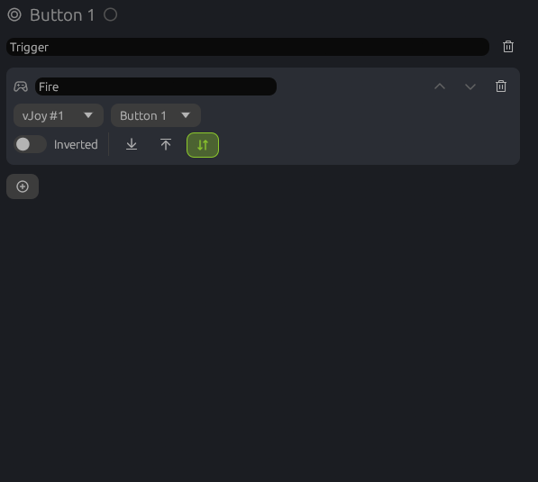

### Map to gamepad

Linux only for now. Sends the value to a virtual **Xbox-style gamepad**: games, Steam and Proton see an Xbox 360
controller, so games that only understand gamepads can be played with a stick. Add the gamepad on the *Virtual
joysticks* page first (up to four), then pick it and a control that suits the input:

- a button presses a gamepad button, a d-pad direction or a trigger;
- an axis moves a stick axis or a trigger (the whole axis range becomes the trigger's travel);
- a hat drives the d-pad.

Buttons and axes can be inverted.

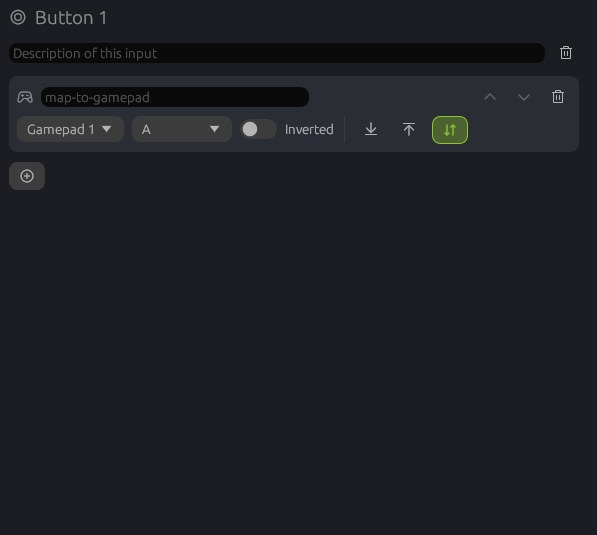

### Map to keyboard

Presses keys while the input is held: they go down in order and come up in reverse order. Click the field and press
the keys to record them. If the input is let go in another mode, the keys still come up.

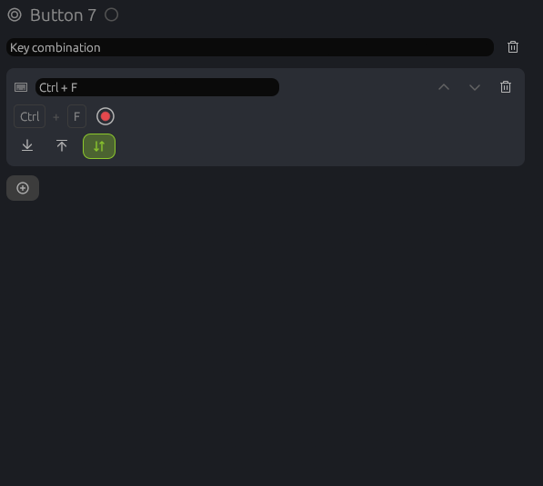

### Map to mouse

A button clicks a mouse button (left, right, middle, back, forward) or turns the wheel one notch. An axis or a hat
moves the cursor instead: set the direction and the speed range; the further the axis is pushed, the faster the
cursor moves.

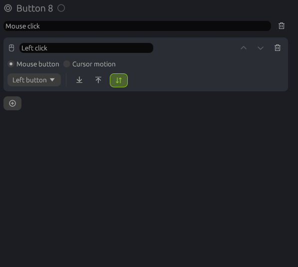

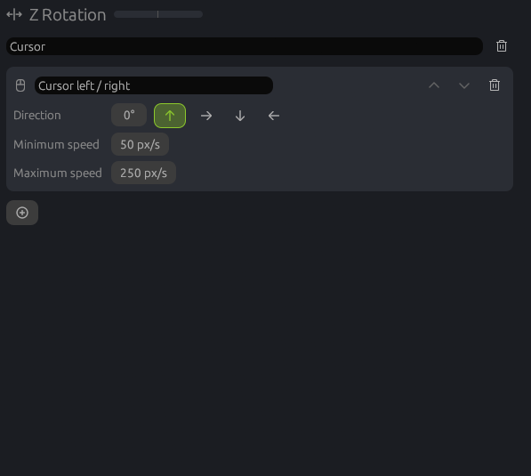

### Map to logical device

The **Logical device** tab is a joystick that only exists inside the profile. Mapping inputs to it lets several
physical inputs feed one logical input, whose own actions then do the rest. Logical inputs are added and renamed
on that tab.

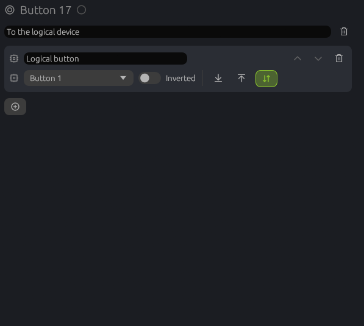

## Axes

### Response curve

Shapes an axis: drag the points of the curve, double-click to add one, right-click to remove one; a right click
on empty space inverts the curve (can be turned off in the settings). Linear, cubic
spline, smooth (no overshoot) and Bézier curves. A cubic spline can swing past its points, turning back or running
into the end of the axis; the smooth curve stays between them. *Symmetric* mirrors your edits through the center; *Invert* flips the curve. The
deadzones below the chart set where the axis does nothing: at both ends and around the center. Put the curve
before *Map to vJoy*, which then sends the shaped value.

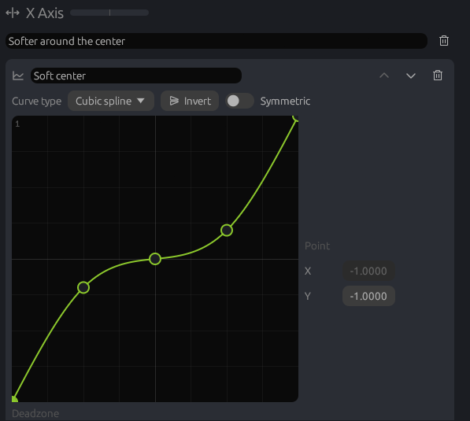

### Split axis

Splits an axis at a point (the center by default) into two halves, and gives each half its own actions; each
half is stretched to the full range again. Useful for one axis driving two outputs, like two pedals on a single
rudder axis.

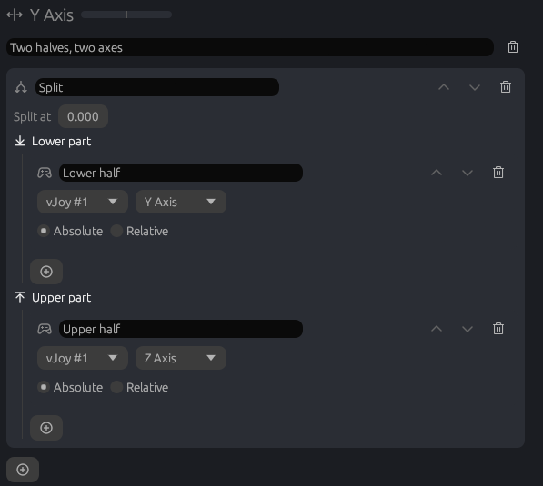

### Merge axis

Combines two axes into one value: average, minimum, maximum, sum, difference (for two pedals as one rudder),
the one deflected most, or the one closer to the center. It runs when either axis moves, so it is bound to both:
picking an axis in its editor binds it there (and removes it from the axis it no longer reads), and linking an
existing new merge to another axis makes that its second axis. A merge reads two axes, so it cannot be linked to a
third one.

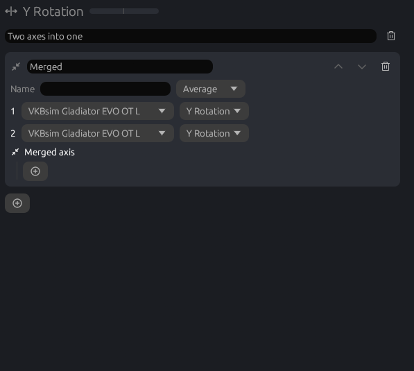

### Dual axis deadzone

A round deadzone for two axes of one stick (X and Y), instead of a square one per axis: the stick has to leave
a circle of the inner size before either axis moves. Each axis then goes to its own list of actions.

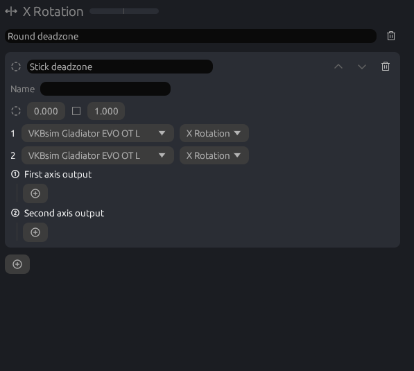

### Axis delta

Turns movement into button presses: every time the axis has moved by the threshold, it presses the actions of
that direction once. Good for a rotary or a slider that should step something up and down.

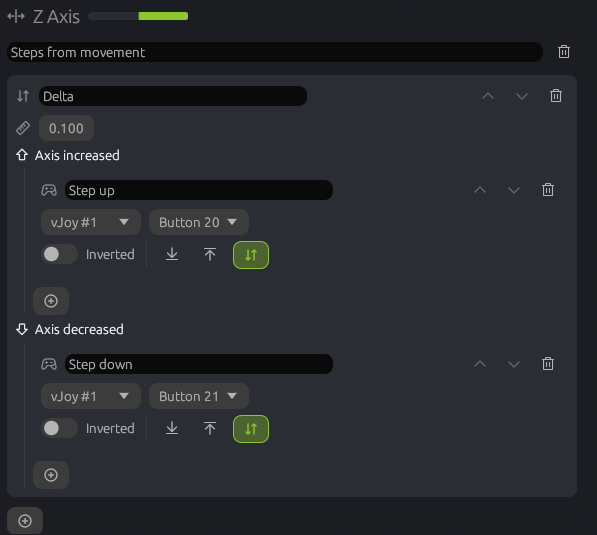

## Buttons and hats

### Tempo

A short press and a long press do different things. Set the time that counts as long, and whether the long
action starts as soon as that time has passed or when you let go.

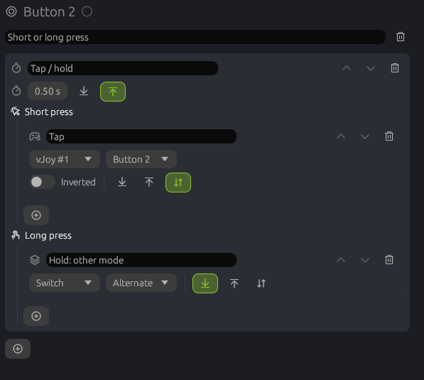

### Double tap

A single press and a quick double press do different things. *Exclusive* waits to see if a second press comes,
so a double press runs only the double actions. *Combined* runs the single actions at once and adds the double
ones when the second press comes.

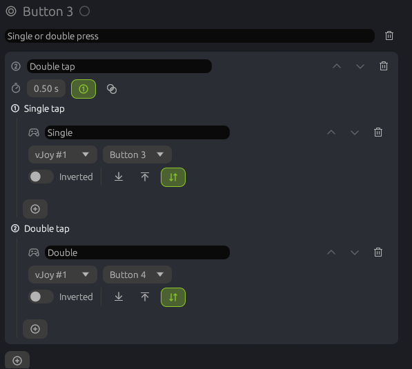

### Smart toggle

A quick press switches its actions on until the next press; holding the button longer works like a normal
button and lets go with it.

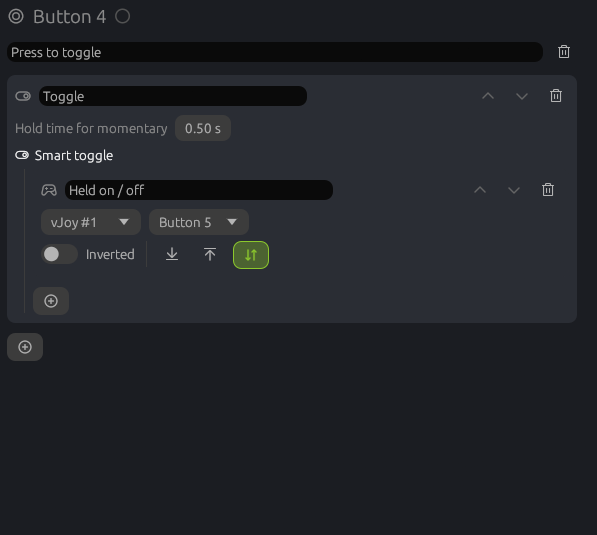

### Chain

Every press runs the next step: first press step 1, second press step 2, and around again. With a timeout, a
pause longer than that starts again from step 1.

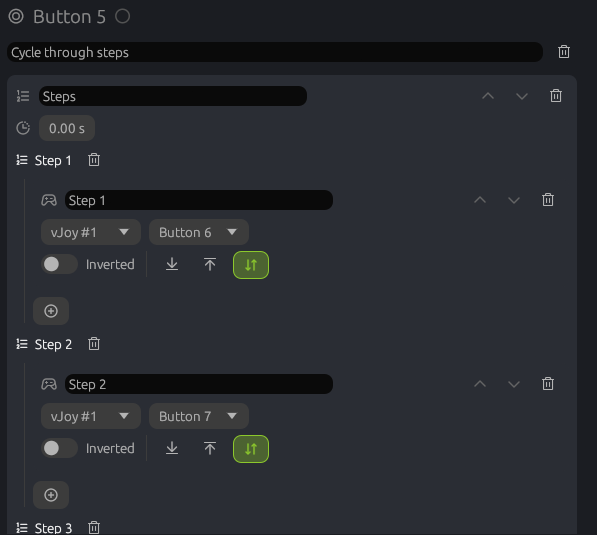

### Macro

Plays a sequence of steps: keys, mouse buttons and motion, vJoy buttons, axes and hats, and pauses. It can run
once, a number of times, while the button is held, or until the next press.

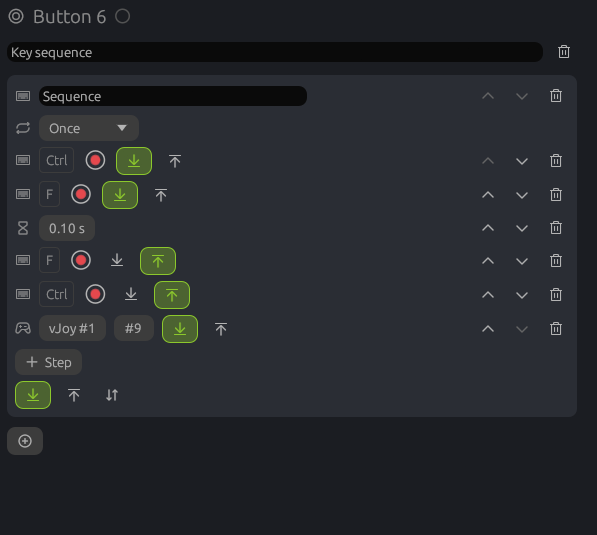

### Hat buttons

Makes a hat four (or eight) buttons, one per direction, plus one for the center. Each direction gets its own
actions; with four buttons, diagonals press none.

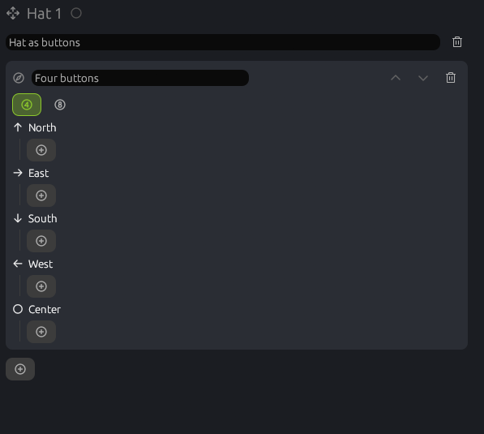

### Condition

Runs one list of actions when its conditions hold and another when they don't. A condition can look at a button,
axis or hat of any controller, at keyboard keys, at the input itself or at what was last sent to vJoy; *all* or
*any* of them has to hold. A button keeps the branch it was pressed in until it is released.

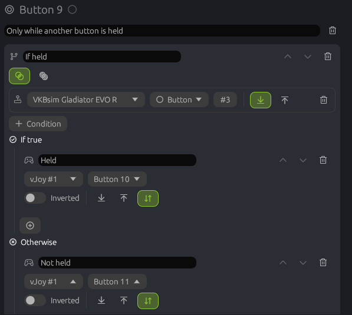

## Profile

### Change mode

Switches the profile's mode: to a given mode, back to the previous one, back through all previous ones, to the
next one of a cycle, or only while the button is held (*Temporary*).

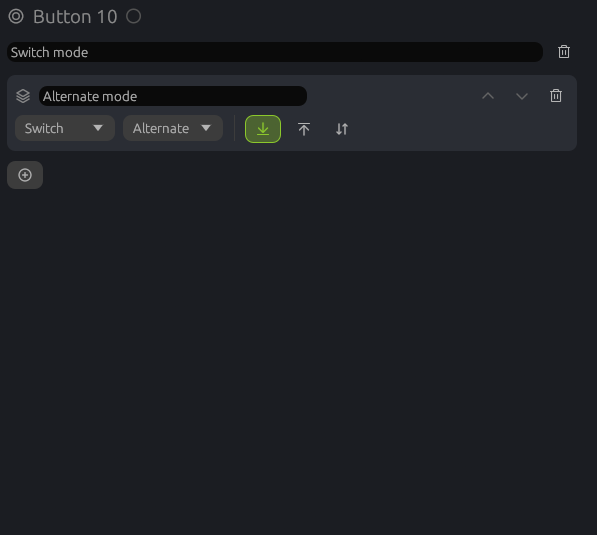

### Pause and resume

Pauses the running profile, resumes it, or toggles between the two. While paused, only inputs with this action
(and *Load profile*) still work.

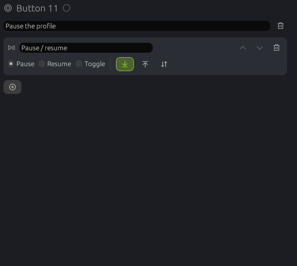

### Load profile

Opens another profile and starts it, asking first if the current one has unsaved changes.

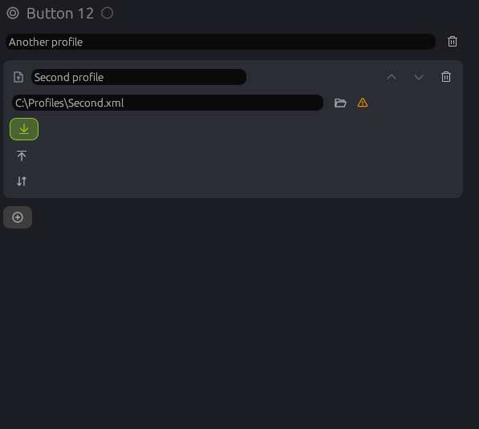

## Other

### Play sound

Plays a sound file (wav, mp3, ogg or flac) at the set volume; the ▶ button plays it right away.

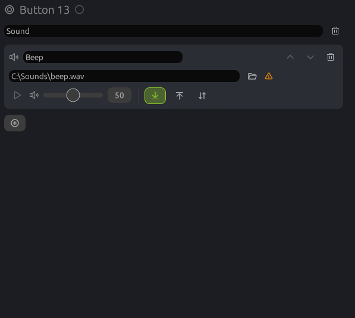

### Text to speech

Speaks a text with a voice of the system. `${current_mode}` becomes the name of the active mode. Speed, volume and
pitch can be set; the new text can wait for the current one or interrupt it.

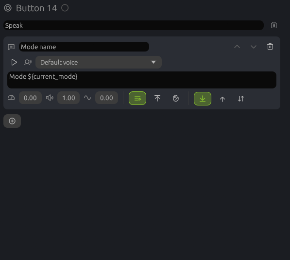

### Run command

Starts a program, with arguments if needed.

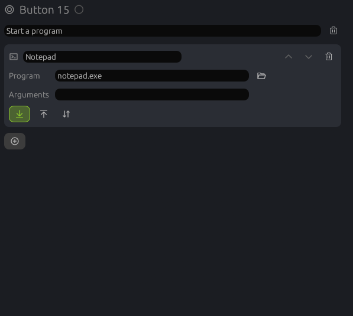

### Description

A note that does nothing when the input is used: what this input is for, for you and whoever uses the profile
next.

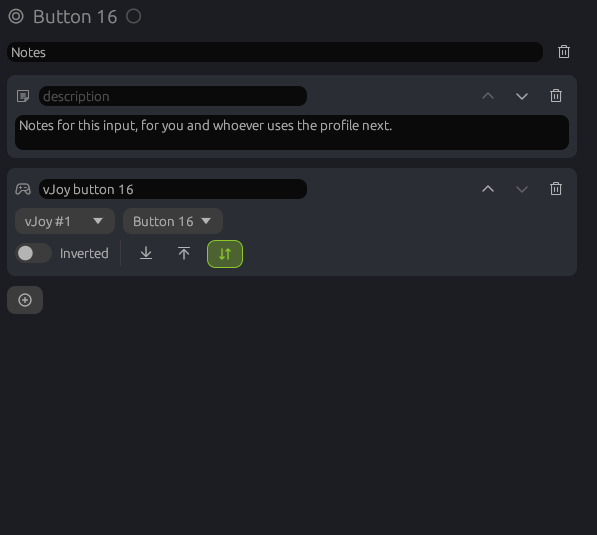
